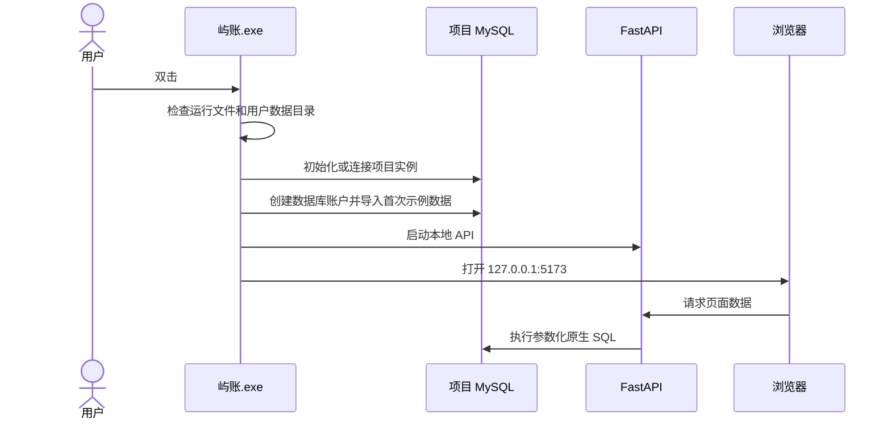

# 应用启动方案

## 面向用户的结果

用户不需要打开 PowerShell，不需要知道 Python、端口、数据库名，也不需要执行 SQL。发布包中的 `屿账.exe` 是唯一入口：双击后自动准备项目专属 MySQL、启动 API 和页面服务，随后打开浏览器。用户只在页面中操作。启动器不依赖 tkinter 或其他 Python GUI 组件，错误会通过 Windows 系统提示框显示。

首次启动会在用户目录创建项目数据和随机密码，自动导入虚构示例数据；后续启动检测到已有数据后直接保留。窗口中的状态和错误提示使用普通用户能理解的语言，并提供日志位置供排查。关闭启动器会停止本项目服务，不操作电脑中其他 MySQL 或 PostgreSQL 服务。

## 发布形态

推荐提供一个压缩包或安装包，内部结构如下：

```text
屿账/
├─ 屿账.exe              # 用户唯一需要双击的文件
├─ mysql/                # 项目专属 MySQL 服务器运行文件
└─ 使用说明.txt          # 面向用户的简短说明
```

`package_release.ps1` 会用 PyInstaller 生成启动器，并复制本机 MySQL Server 目录作为随包服务器。完整 MySQL 运行文件体积较大，但保留了原生 SQL、事务、触发器和存储过程的课程数据库能力。最终发布前应使用 MySQL 官方可再分发安装包或安装器确认许可证和第三方声明。

启动器和前端资源被打进 `屿账.exe`；数据库文件不写入安装目录，而写到 `%LOCALAPPDATA%\Shujuku\data`，避免普通用户没有安装目录写权限。项目数据库只绑定 `127.0.0.1:3307`，API 和页面只绑定本机地址。启动器保留一个原生 Windows 窗口，包含“打开应用”“查看日志”“退出应用”；关闭窗口也会正常停止本项目服务。关闭浏览器只关闭页面。再次双击同一应用会聚焦现有窗口，不重复启动服务。

## 运行流程



## 失败处理

| 情况 | 用户看到的结果 | 保护行为 |
| --- | --- | --- |
| 找不到随包 MySQL | 明确提示“发布包不完整” | 不使用或停止其他数据库 |
| 3307 被其他实例占用 | 提示端口冲突并停止 | 通过项目 server UUID 拒绝接管 |
| 数据库启动失败 | 指向项目日志的提示 | 不启动半可用页面 |
| 8000/5173 被占用 | 启动失败并提示重试 | 不杀掉未知进程 |
| 已有用户数据 | 显示“保留原数据” | 不重复导入、不清库 |
| 关闭启动器 | 安全停止本项目服务 | 不影响 MySQL80、PostgreSQL 等无关服务 |

## 为什么保留浏览器

浏览器承载现有页面，避免重写业务 UI；课程演示时可以查看页面、API 文档和数据库结果。后续如需要真正的原生窗口，可在同一 API 和前端之上增加 WebView2 外壳，用户数据和数据库不需要迁移。当前阶段不采用 Electron，减少打包体积和额外运行时。

## 构建和验收

开发者构建：

```powershell
.\.venv\Scripts\python.exe -m pip install -r requirements-dev.txt
.\package_release.ps1
```

产物位于 `release\屿账\屿账.exe`。在没有开发虚拟环境的测试机上，将整个 `屿账` 文件夹复制到新目录，双击 exe，确认首次启动、关闭、再次启动和数据保留。验证页面四类展示、订阅新增和浏览器打开。发布包不提交 Git，数据库真实数据不进入仓库。

## 本次实际验收

`tests/launcher_exe.py` 对真正的发布 EXE 运行了七项检查，全部通过，记录见 [launcher-exe.json](evidence/launcher-exe.json)。测试从子进程 PATH 中移除 Python 和 MySQL，使用新的隔离用户数据目录；同一 EXE 连续启动、退出两轮，并通过真实窗口的“退出应用”按钮正常关闭，确认 8000/5173/3307 均释放。还验证了重复双击不会创建额外服务、新增支付方式重启后保留，以及 Chrome 能正确显示 175 元统计。截图见 [发布版浏览器](evidence/launcher-browser.png)。

验证范围是当前 Windows 机器的冻结程序运行与去除 PATH 依赖，尚未在另一台干净 Windows 机器验证。没有要求普通用户安装开发工具。

已解决的发布问题：

- 移除 tkinter 依赖，使用 ctypes 调用原生 Windows 窗口。
- 隐藏控制台时为 stdout/stderr 提供日志文件，避免服务日志初始化异常。
- 为随包 MySQL 使用 ASCII argv[0] 和明确的安装/数据路径；Windows 路径选项使用系统编码，支持本机中文发布路径。
- 初始化选项文件存放在数据目录外，避免空目录初始化被配置文件阻止。
- 用数据库 UUID 检查实例归属；用文件锁及原生窗口处理重复双击；健康检查通过后才打开页面。
- 关闭启动器后正常关闭数据库，不依赖任务管理器或强制杀进程。

首次打开的是独立用户数据目录，原开发目录 `.runtime/` 保留不变，当前不自动迁移开发数据。用户数据随退出/重启保留，升级发布文件不重新导入示例。
