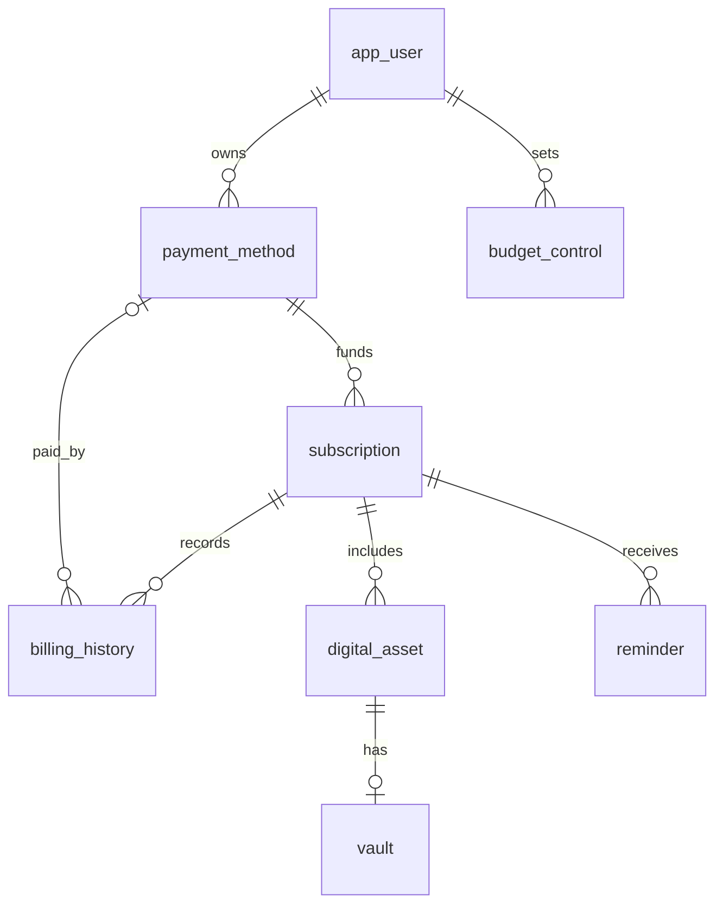
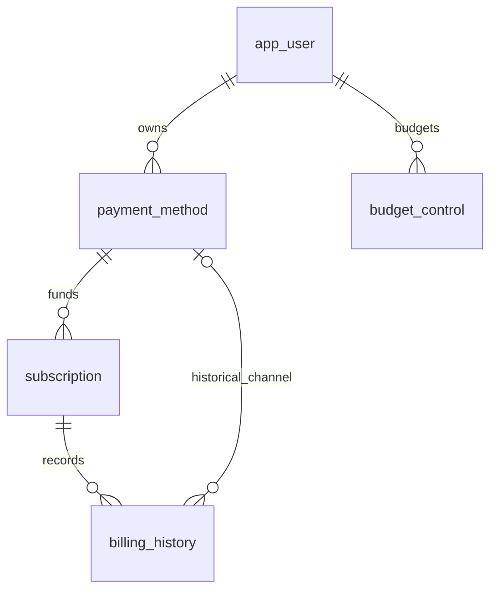
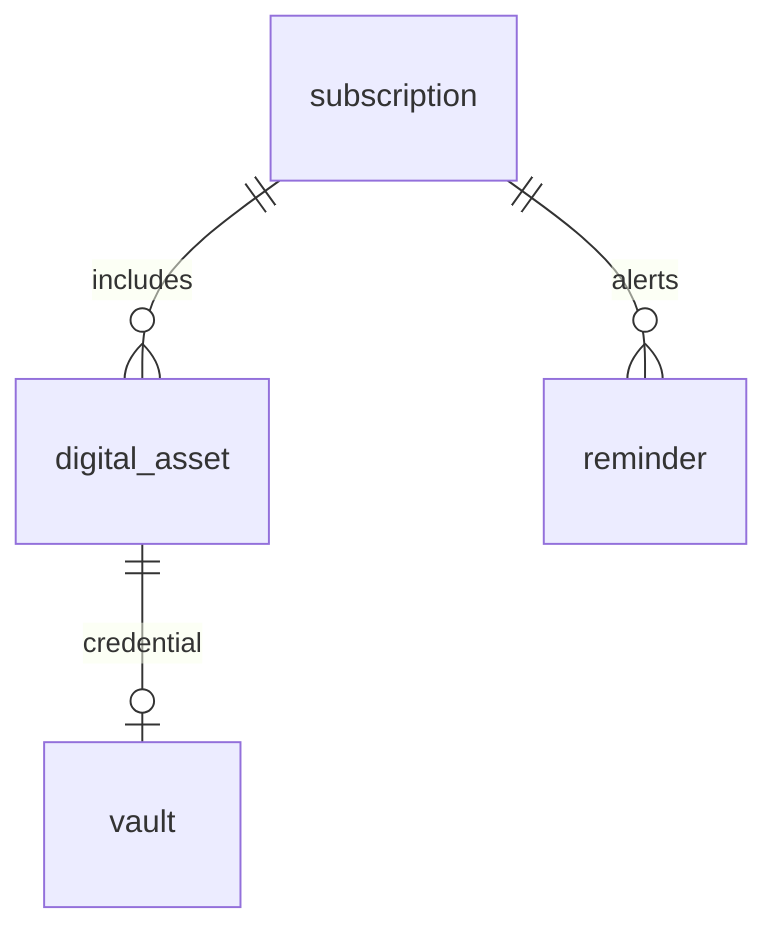

# 数据库设计（第 8 周初版）

## 关系与 E-R 图

数据库含 8 张核心表。归属沿用户 → 支付方式 → 订阅向下推导，避免各表重复保存用户 ID。历史支付方式独立记录，保证以后变更默认渠道时不改写历史渠道。

全局 E-R（字段详见后表与 SQL）：

局部 E-R 1：订阅与财务。

局部 E-R 2：资产与提醒。

说明：每条 CHARGE 必须有支付方式，CANCEL 必须没有；因此 billing_history → payment_method 在全局层面为可选关联。所有子记录都必须有父记录；不采用级联删除。一个订阅可有多个资产，一项资产最多一条凭据。

## 关系模式与字段字典

以下每行表示一个关系模式，`id` 是主键；每个字段的 SQL 类型、空值和约束都直接对应 `database/001_schema.sql`，脚本是可执行定义。

### app_user（用户）

| 字段 | 类型/空值 | 含义/约束 |
| --- | --- | --- |
| id | BIGINT UNSIGNED / 非空 | 自增主键 |
| display_name | VARCHAR(60) / 非空 | 演示显示名 |
| email | VARCHAR(120) / 非空 | 唯一邮箱标识，示例使用保留域名 |
| created_at | DATETIME / 非空 | 默认 CURRENT_TIMESTAMP |

### payment_method（支付方式）

| 字段 | 类型/空值 | 含义/约束 |
| --- | --- | --- |
| id | BIGINT UNSIGNED / 非空 | 自增主键 |
| user_id | BIGINT UNSIGNED / 非空 | 外键 app_user.id |
| label | VARCHAR(60) / 非空 | 用户内唯一显示名，与 user_id 联合唯一 |
| channel | VARCHAR(20) / 非空 | bank / alipay / wechat / other |
| last_four | CHAR(4) / 可空 | 虚构支付尾号，CHECK 4 位数字 |

### subscription（订阅）

| 字段 | 类型/空值 | 含义/约束 |
| --- | --- | --- |
| id | BIGINT UNSIGNED / 非空 | 自增主键 |
| payment_id | BIGINT UNSIGNED / 非空 | 当前默认支付方式外键 |
| name | VARCHAR(100) / 非空 | 服务名称，不强制同名服务唯一 |
| category | VARCHAR(20) / 非空 | productivity / entertainment / storage / learning / other |
| amount | DECIMAL(10,2) / 非空 | 本周期金额，CHECK 大于 0 |
| cycle_months | SMALLINT / 非空 | CHECK 1 / 3 / 6 / 12 |
| next_billing_date | DATE / 非空 | 当前下一次预计续费日 |
| status | VARCHAR(12) / 非空 | active / cancelled |
| auto_renew | BOOLEAN / 非空 | 自动续费；cancelled 必须为 false |
| created_at | DATETIME / 非空 | 创建时间 |

### billing_history（财务事件历史）

| 字段 | 类型/空值 | 含义/约束 |
| --- | --- | --- |
| id | BIGINT UNSIGNED / 非空 | 自增主键 |
| subscription_id | BIGINT UNSIGNED / 非空 | 订阅外键 |
| payment_id | BIGINT UNSIGNED / 可空 | 实际扣款渠道外键，与订阅当前默认渠道分别保存 |
| event_type | VARCHAR(10) / 非空 | CHARGE 或 CANCEL |
| amount | DECIMAL(10,2) / 非空 | CHARGE >0；CANCEL =0 |
| occurred_on | DATE / 非空 | 业务发生日期 |
| event_key | VARCHAR(100) / 非空 | 全局唯一幂等键；无需解析此键获得业务字段 |

历史金额是该次事件的事实，不是当前订阅价格的副本；订阅调价不会修改历史。当前类别报表使用订阅类别，后续若允许类别修改，应明确报表按当前类别还是历史类别，必要时增加事实快照。

### digital_asset（数字资产）

| 字段 | 类型/空值 | 含义/约束 |
| --- | --- | --- |
| id | BIGINT UNSIGNED / 非空 | 自增主键 |
| subscription_id | BIGINT UNSIGNED / 非空 | 订阅外键 |
| name | VARCHAR(100) / 非空 | 资产名称 |
| acquired_on | DATE / 非空 | 获得日期；从未使用时作为闲置起点 |
| last_used_on | DATE / 可空 | 最后使用日期，不能早于获得日期 |

### vault（凭据占位）

| 字段 | 类型/空值 | 含义/约束 |
| --- | --- | --- |
| id | BIGINT UNSIGNED / 非空 | 自增主键 |
| asset_id | BIGINT UNSIGNED / 非空 | 唯一外键 digital_asset.id |
| login_name | VARCHAR(100) / 非空 | 虚构登录名 |
| secret_ciphertext | VARBINARY(1024) / 非空 | 密文字节位置；本轮仅 DEMO_ONLY 占位，不提供密码功能 |

### reminder（提醒）

| 字段 | 类型/空值 | 含义/约束 |
| --- | --- | --- |
| id | BIGINT UNSIGNED / 非空 | 自增主键 |
| subscription_id | BIGINT UNSIGNED / 非空 | 提醒关联的订阅外键 |
| kind | VARCHAR(12) / 非空 | renewal / budget |
| message | VARCHAR(200) / 非空 | 生成时的提示文本事实，不要求跟随服务更名更新 |
| due_on | DATE / 非空 | 业务提醒日期 |
| status | VARCHAR(12) / 非空 | pending / done / revoked |
| dedup_key | VARCHAR(100) / 非空 | 唯一去重键；作为不透明外部标识 |

### budget_control（月预算）

| 字段 | 类型/空值 | 含义/约束 |
| --- | --- | --- |
| id | BIGINT UNSIGNED / 非空 | 自增主键 |
| user_id | BIGINT UNSIGNED / 非空 | 用户外键 |
| month_start | DATE / 非空 | 月首，CHECK DAY=1；与用户联合唯一 |
| amount | DECIMAL(10,2) / 非空 | 当月预算，CHECK >0 |

## 候选键、函数依赖与 3NF

默认只认业务声明的依赖，不将样例数据偶然唯一误当候选键。记 `X → 其余字段` 为 X 确定整条记录其他字段。

| 关系 | 候选键 | 非平凡依赖 | 规范化说明 |
| --- | --- | --- | --- |
| app_user | id；email | 每个候选键 → 其余字段 | 名称不唯一，不存部门等可传递属性 |
| payment_method | id；(user_id,label) | 每个候选键 → 其余字段 | 渠道不决定尾号或 label；无对复合键子集的非键依赖 |
| subscription | id | id → 其余字段 | 不存用户名、渠道名、月折算值；payment_id 不决定其余订阅属性 |
| billing_history | id；event_key | 每个候选键 → 其余字段 | 不存订阅名；subscription_id 不决定历史金额、渠道和日期 |
| digital_asset | id | id → 其余字段 | 订阅不决定资产名和使用日期，允许多资产 |
| vault | id；asset_id | 每个候选键 → 其余字段 | 一资产一凭据，不存资产名称和所属订阅 |
| reminder | id；dedup_key | 每个候选键 → 其余字段 | message 是事件文本，不是从订阅名机械推导的属性 |
| budget_control | id；(user_id,month_start) | 每个候选键 → 其余字段 | 用户或月份单独均不决定预算 |

字段均为原子值，满足 1NF；非键字段完全依赖候选键，满足 2NF；无非键属性经其他非键属性决定的传递依赖，满足 3NF。枚举限制和 CANCEL 固定零金额是业务域/条件约束，不能据此声称 event_type 全局决定 amount 或 payment_id。

与不合理扁平表相比：订阅与历史流水拆开，避免续费覆盖历史；支付方式拆开，避免同一渠道信息重复；用户只保存在归属根；预算单独按月份保存，避免每个订阅重复月预算。

## 索引与存储引擎

所有表采用 InnoDB，以便后续事务、行锁、外键及触发器在同一事务内工作。字符集 utf8mb4，排序规则 utf8mb4_0900_ai_ci。CHECK 需要 MySQL 8.0.16 及以上。

| 索引 | 类型/字段 | 场景与依据 |
| --- | --- | --- |
| 各表 PRIMARY | 唯一 B-tree / id | 单条定位和关联 |
| app_user.email | 唯一 B-tree | 邮箱业务唯一 |
| uq_payment_label | 唯一 B-tree / user_id,label | 用户下渠道去重、用户支付列表 |
| ix_sub_status_due | B-tree / status,next_billing_date | 活跃订阅续费日范围扫描 |
| ix_billing_type_date | B-tree / event_type,occurred_on | 实际扣费月份范围查询，排除 CANCEL |
| billing_history.event_key | 唯一 B-tree | 续费/取消重试幂等 |
| ix_asset_last_used | B-tree / last_used_on | 后续直接使用日期过滤；当前 COALESCE 不保证可用该索引 |
| vault.asset_id | 唯一 B-tree | 一对一凭据限制 |
| ix_reminder_status_due | B-tree / status,due_on | 待完成提醒日期排序 |
| reminder.dedup_key | 唯一 B-tree | 防重复提醒 |
| uq_budget_month | 唯一 B-tree / user_id,month_start | 用户月预算定位 |
| 外键支撑索引 | B-tree / 各外键前缀 | InnoDB 在不存在可用前缀索引时自动建立，支持关联检查 |

小数据集 EXPLAIN 可能选全表扫描，不夸大性能提升。后续性能评估应增加真实分布的虚构样本、EXPLAIN 和耗时证据后再调整索引；当前没有建立重复或无依据的所有字段索引。

实现依据：[MySQL 初始化文档](https://dev.mysql.com/doc/refman/8.0/en/data-directory-initialization.html)、[PyMySQL 参数化执行示例](https://pymysql.readthedocs.io/en/latest/user/examples.html)。
