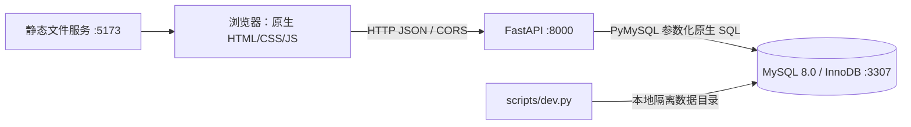

# 架构与接口（第 8 周）

## 运行架构



不采用 ORM、数据库 Model 或自动建表。FastAPI 负责路由和请求校验，Pydantic 只是请求结构校验；所有数据操作以显式 SQL 经 PyMySQL 游标执行。前端从独立静态服务运行，不使用后端模板。CORS 仅允许本机两个前端源。

本机环境：Windows / PowerShell，Python 3.13.0、MySQL Community Server 8.0.46、Node 24.17.0。前端无构建工具依赖，运行不需要 Node。Python 包版本见 requirements.txt 和验收时保存的 requirements-lock.txt。

项目专属 MySQL 在 `.runtime/mysql/`，端口 3307，仅绑定 127.0.0.1，禁用 mysqlx。启动不接管原有 3306 的 MySQL80，也不更改现有 PostgreSQL 服务。初始化 root 密码和应用密码随机生成，放在被 Git 忽略的 `.runtime/db.json`；接口使用仅具有当前库 SELECT/INSERT/UPDATE/DELETE 的 lab_app。建表用项目实例管理员连接。

这是本地单用户课程演示，不包含鉴权、共享部署或生产凭据库。固定用户 ID=1。不要将服务暴露到公网。

## 接口格式

基础地址：`http://127.0.0.1:8000/api`，交互文档 `/docs`，机器可读定义 `/openapi.json`。

日期 `YYYY-MM-DD`，月份 `YYYY-MM`。金额可能以 JSON 十进制字符串返回，前端只用于格式化显示；数据库和后端计算用 DECIMAL/Decimal。没有分页：第 8 周本地小样本返回全部，搜索在前端执行；数据规模扩大后再补分页。

| 方法 | 路径 | 输入 | 成功结果 |
| --- | --- | --- | --- |
| GET | /health | 无 | 数据库版本、阶段、基准日 |
| GET | /payments | 无 | id,label,channel,last_four 列表 |
| POST | /payments | PaymentInput | 201，新记录及 id |
| DELETE | /payments/{id} | 正整数 ID | deleted；被引用则 409 |
| GET | /subscriptions | 无 | 含支付标签的订阅列表 |
| POST | /subscriptions | SubscriptionInput | 201，新记录及 id、active 状态 |
| PATCH | /subscriptions/{id} | name/amount/next_billing_date/auto_renew 至少一项 | id,updated |
| DELETE | /subscriptions/{id} | ID | deleted；仅误建未引用记录可删 |
| GET | /dashboard?month=2026-11&as_of=2026-11-10 | month 可选、as_of 可选 | 指标、预算、分类支出、资产、pending 提醒 |
| GET | /calendar?month=2026-11 | month 可选 | 当前月 active/auto_renew 下次扣费列表 |

标准错误：404 记录不存在；409 唯一/引用冲突或修改已取消订阅；422 输入、日期或支付方式无效；503 数据库暂不可用。错误使用 `detail` 字段；422 参数校验 detail 可能为列表，前端统一读取。服务端记录数据库故障，响应不暴露连接凭据和原始 SQL。

例：

```json
POST /api/subscriptions
{
  "payment_id": 1,
  "name": "示例服务",
  "category": "productivity",
  "amount": "12.50",
  "cycle_months": 1,
  "next_billing_date": "2026-11-20",
  "auto_renew": true
}
```

输入不接受额外字段；PATCH 不接受 status、payment_id、category、cycle_months、null 或空修改。避免未经事务设计就把“取消”降级为直接修改 status。

## 页面结构与状态

左栏提供资产总览、订阅、日历、资产和支付方式锚点；顶部月份选择与添加订阅；主体依次为四项指标、日历与预算、订阅表、资产饼图与提醒、支付方式卡片。新增/编辑使用原生 dialog，不要求切换页面。

全部指标、日历、饼图、进度条都来自接口实际查询，无模拟图表数据。种子数据本身是虚构业务样本，并在页面标注。初始月份实际扣费 175 元、预算 200 元、4 个活跃订阅、2 个闲置续费资产；取消事件不计支出。切月仅改变月统计和日历，不改变当前订阅存量或基准日。

加载、错误重试、空列表、无预算、已取消、不可删除等状态有明确提示。使用 CSS conic-gradient 绘制资产饼图、原生进度条和月历布局，无外部 CDN 依赖；图表有文字数量说明和辅助标签。样式适配桌面与手机尺寸，实际浏览器结果见验收记录。
