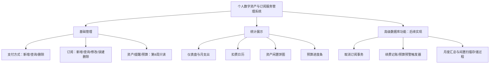
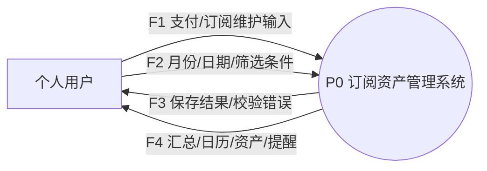
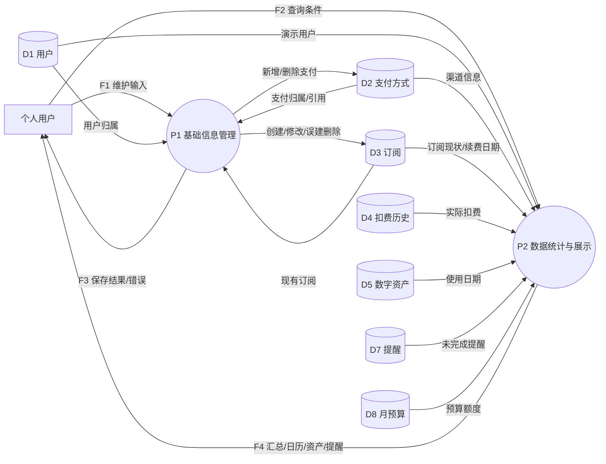

# 需求与业务设计（第 8 周初版）

## 范围和使用者

系统面向一个本地演示用户，统一管理支付方式、订阅、扣费、数字资产、凭据占位、提醒和月预算。金额均为 CNY，日期为无时区业务日期。基础管理和真实数据库统计本轮实现；真实扣款、登录鉴权、真实密码托管、取消事务、续费触发器、存储过程和模拟定时任务不在第 8 周实现范围内。

演示基准日固定为 `2026-11-10`，初始展示月份 `2026-11`，避免课程演示随电脑日期变化。统计接口可接收 `as_of`，该参数只改变闲置判断，不产生扣款或更新数据。生产部署与真实凭据处理须另作设计。

## 功能模块图

## 数据流图

顶层图（整个系统作为一个处理）：

0 层图（和顶层保持输入输出平衡；数据存储对应实际表）：

D6 凭据库在本轮只建表并有虚构占位记录，没有数据流入页面或 API。后续增加凭据处理时须补充对应处理与加密边界。以上为第 8 周实际范围的 DFD，不把未来功能伪画成已经存在。

## 业务规则与决策

| 决策 | 约定 | 实现/阶段 |
| --- | --- | --- |
| D-01 技术栈 | MySQL 8.0.46 / InnoDB，FastAPI，PyMySQL 原生游标，原生静态前端 | 本轮 |
| D-02 终止记录 | billing_history 分 CHARGE/CANCEL；CANCEL 金额 0、支付渠道为空，统计仅取 CHARGE | 表约束/种子数据本轮；取消操作后续 |
| D-03 续费事件 | 不把普通修改下次扣费日当成续费成功；后续需显式续费序号和幂等事件键 | 方案见高级功能设计 |
| D-04 预算 | 按自然月、用户、CNY 汇总实际扣费；月预算唯一；超支提醒去重和并发锁后续实现 | 只读统计本轮 |
| D-05 闲置 | `COALESCE(last_used_on,acquired_on) < DATE_SUB(as_of, INTERVAL 3 MONTH)` 且 active/auto_renew；等于三个月不计超过 | SQL/API 本轮 |
| D-06 模拟时间 | 当前统一演示基准日；未来任务接受同一业务日期，不能改系统时间 | 查询本轮，任务后续 |
| D-07 删除/历史 | 默认外键 RESTRICT；仅允许删除没有关联记录的误建数据；历史金额与当时支付渠道保存到流水 | 本轮 |
| D-08 取消边界 | 原子更新订阅、写 CANCEL、撤销该订阅 pending 的续费提醒；预算提醒保留审计意义 | 方案后续实现 |

补充约定：

- 订阅仅通过支付方式确定所属用户，避免冗余 user_id 导致传递依赖。订阅类别是可选枚举，不另建第九张类别表。
- 一个订阅对应多个数字资产；每个资产最多一个凭据记录。第 8 周只管理订阅型资产，不引入无订阅的独立资产。
- 活跃数包含所有 active 订阅；日历只显示 active 且自动续费的下一个扣费日期，不模拟长期周期展开。
- 每月折算费用为 active 订阅的 `amount / cycle_months` 之和，仅用于估算，不能当成实际支出。
- 闲置饼图按资产计数，分类互斥：近期使用、闲置且续费、非自动续费（含已取消）。没有资产时展示零项状态。
- 已取消订阅不允许通过普通 PATCH 重新激活；删除被引用数据返回冲突，不能绕过外键清除历史。
- 所有名称为用户输入，SQL 使用参数绑定，页面按文本转义输出。金额最多两位小数，拒绝空名称、非法月份、未知字段和 null 修改。

## 数据字典：数据项与结构

完整逐字段定义见《数据库设计.md》和 `database/001_schema.sql`；下列是处理之间流动的数据结构。

| 结构 | 数据项 | 校验与用途 |
| --- | --- | --- |
| PaymentInput | label、channel、last_four? | label 1～60 字；channel 枚举；尾号为 4 位虚构数字或空 |
| SubscriptionInput | payment_id、name、category、amount、cycle_months、next_billing_date、auto_renew | 外键有效；正金额；周期为 1/3/6/12 月；合法日期 |
| SubscriptionPatch | name?、amount?、next_billing_date?、auto_renew? | 至少一项，不允许 null；不接受 status 等其他字段 |
| QueryPeriod | month、as_of? | 月份 1900-01～9998-12；基准日期默认 2026-11-10 |
| Dashboard | spending、budget?、active_count、monthly_estimate、categories[]、assets[]、reminders[] | 实际扣费、估算和存量分开；budget=null 表示未设置 |
| CalendarEvent | id、name、amount、next_billing_date | 预计续费而非扣款流水 |

## 数据字典：数据流与数据存储

| 数据流 | 来源 → 去向 | 数据结构/内容 |
| --- | --- | --- |
| F1 | 用户 → P1 | PaymentInput / SubscriptionInput / SubscriptionPatch / 删除 ID |
| F2 | 用户 → P2 | QueryPeriod；搜索词仅在前端筛选当前列表 |
| F3 | P1 → 用户 | 新 ID、修改结果、删除结果，或 404/409/422/503 错误 |
| F4 | P2 → 用户 | 订阅/支付列表、Dashboard、CalendarEvent[] |

| 存储 | 表 | 写入/读取规则 |
| --- | --- | --- |
| D1 | app_user | 种子数据创建固定演示用户；接口通过 USER_ID 使用 |
| D2 | payment_method | P1 维护，P2 读取；已引用不可删 |
| D3 | subscription | P1 维护，P2 读取；不通过基础接口取消 |
| D4 | billing_history | 本轮种子数据写入、P2 读取；后续事务/触发器写入 |
| D5 | digital_asset | 本轮种子数据写入、P2 读取 |
| D6 | vault | 仅占位；本轮不对外读取或写入 |
| D7 | reminder | 本轮种子数据写入、P2 读取 pending |
| D8 | budget_control | 本轮种子数据写入、P2 读取指定月份 |

## 基础业务验收场景

1. 新增“测试支付方式”，在订阅表单选择它，创建订阅；列表、活跃数、月折算额、日历随数据库变化。
2. 修改新订阅金额并关闭自动续费；数据库与页面更新，日历不再包含该条。
3. 删除无关联的新订阅后再删除支付方式，成功返回；尝试删有历史的种子订阅被拒绝。
4. 切换到没有扣费、没有预算的月份，显示 0 支出和未设置预算，不能展示 NaN/Infinity。
5. 后端不可达时页面显示错误和重试入口，不假装读取成功。
